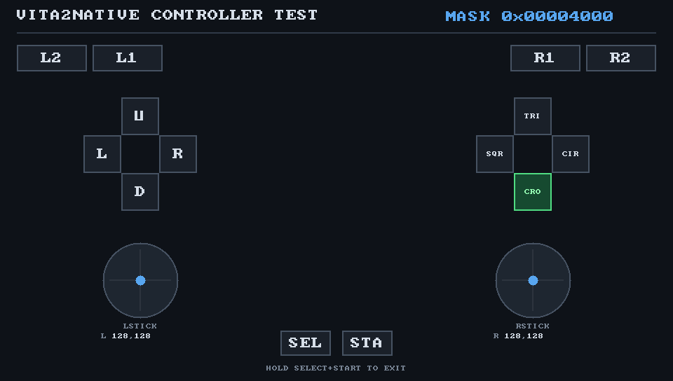

# ctrl_test

Guest-side controller probe. It runs as a normal Vita executable under
`vita2native`, draws the live pad state on screen, and logs every change so the
mapping can be checked end to end (SDL's controller database and the SceCtrl
OR).



## What it does

- Imports `SceCtrl`, `SceLibKernel`, `SceThreadmgr` and `SceDisplayUser`.
- Calls `sceDisplaySetFrameBuf` once. That starts the host video thread, which
  is what opens SDL and samples its controller database; without it no pad is
  sampled at all.
- Renders a 960x544 A8B8G8R8 framebuffer directly in software: D-pad, face
  buttons, L1/L2/R1/R2, Select/Start, both sticks and the raw mask. Pressed
  controls turn green.
- Polls `sceCtrlPeekBufferPositive` every 50 ms. The frame is redrawn and
  presented only when the buttons or axes change, so the test is idle when the
  pad is untouched.
- Logs a one-second heartbeat and a line for every button/axis change:

  ```
  change buttons=0x00001000 lx=128 ly=128 rx=128 ry=128
    SEL=0 STA=0 L3=0 R3=0 UP=0 RGT=0 DWN=0 LFT=0 L2=0 R2=0 L1=0 R1=0 TRI=1 CIR=0 CRO=0 SQR=0
  ```

- Select+Start held for two seconds exits.

The framebuffer is a static 960x544 buffer (about 2 MB of guest RAM).

## Build

Requires Zig; no VitaSDK installation is needed.

```sh
python3 tools/ctrl_test/build.py
```

The result is `build/ctrl-test/ctrl_test.elf`, a fixed-address `ET_SCE_EXEC`
linked at `0x81000000` with two PT_LOAD segments. The build script checks the
module layout, rewrites `e_type`/`e_entry` for the Vita loader, and prints the
segment map.

## Run headed (X11 or Wayland)

Copy the ELF next to `vita2native` and run it under whichever video driver the
host provides:

```sh
env SDL_VIDEODRIVER=wayland VITA2NATIVE_SDL_WINDOWED=1 VITA2NATIVE_SDL_SIZE=960x544 \
    setarch armv7l -R ./vita2native ./ctrl_test.elf
```

`SDL_VIDEODRIVER=x11` works the same way, with `SDL_RENDER_DRIVER=software` on a
host whose X server has no GPU. The window is 960x544 and updates when a control
changes. A pseudo-terminal keeps the guest's `sceClibPrintf` lines line-buffered
so they appear immediately:

```sh
ssh -t <device> 'cd <dir> && env ... ./vita2native ./ctrl_test.elf'
```

## Run headless alongside a title

SDL's joystick subsystem is independent of the video driver, so `dummy` video
still opens a pad while another process owns the display:

```sh
env SDL_VIDEODRIVER=dummy VITA2NATIVE_INPUT_DEBUG=1 \
    setarch armv7l -R ./vita2native ./ctrl_test.elf
```

With `VITA2NATIVE_INPUT_DEBUG=1` the host adds the lines that matter:

```
vita2native: SDL opened controller 0: <pad name>
vita2native: SDL mapping ...<pad name>,a:b0,b:b1,x:b2,y:b3,...
```

## Expected mask

| Button | Mask | Button | Mask |
| --- | --- | --- | --- |
| Select | `0x0001` | Start | `0x0008` |
| L3 | `0x0002` | R3 | `0x0004` |
| Up | `0x0010` | Right | `0x0020` |
| Down | `0x0040` | Left | `0x0080` |
| L2 (ZL) | `0x0100` | R2 (ZR) | `0x0200` |
| L1 | `0x0400` | R1 | `0x0800` |
| Triangle | `0x1000` | Circle | `0x2000` |
| Cross | `0x4000` | Square | `0x8000` |

Sticks report `0..255`, with `128` centered; `0` is up/left and `255` is
down/right. Stick clicks report `L3`/`R3` (`0x0002`/`0x0004`) and highlight the
ring around the corresponding stick. Pad firmware hotkey modifiers
(`BTN_TRIGGER_HAPPY*`) are intentionally ignored: they are not Vita buttons.

## How to read the result

- A single physical press should highlight exactly one control and set exactly
  one bit in the `MASK` readout.
- If pressing one face button highlights both `TRI` and `SQR`, the SDL mapping
  is wrong rather than the buttons being gated off.
- If a press sets no bit, check `VITA2NATIVE_INPUT_DEBUG=1` for whether SDL
  opened a controller (only SDL is used; there is no evdev backend).
- If the wrong bit is set positionally (for example the left face button sets
  `TRI`), the mapping in `source/host/host_video_sdl.c` needs adjusting.
