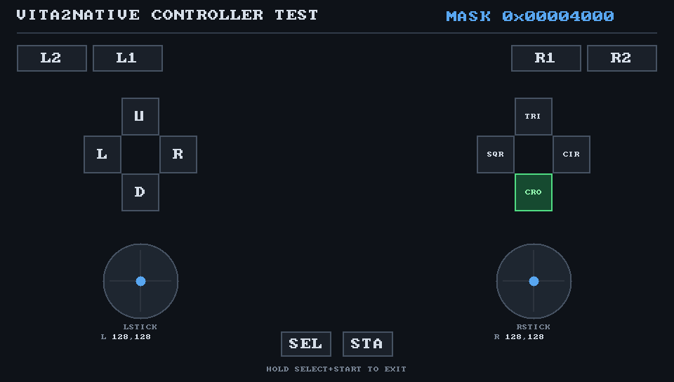

# ctrl_test

Guest-side controller probe. It runs as a normal Vita executable under
`vita2native`, draws the live pad state on screen, and logs every change so the
mapping can be checked end to end (evdev, SDL's controller database, and the
SceCtrl OR).



## What it does

- Imports `SceCtrl`, `SceLibKernel`, `SceThreadmgr` and `SceDisplayUser`.
- Calls `sceDisplaySetFrameBuf` once. That starts the host video thread, which
  is what opens SDL and samples its controller database; without it only the
  evdev path would be live.
- Renders a 960x544 A8B8G8R8 framebuffer directly in software: D-pad, face
  buttons, L1/L2/R1/R2, Select/Start, both sticks and the raw mask. Pressed
  controls turn green.
- Polls `sceCtrlPeekBufferPositive` every 50 ms. The frame is redrawn and
  presented only when the buttons or axes change, so the test is idle when the
  pad is untouched.
- Logs a one-second heartbeat and a line for every button/axis change:

  ```
  change buttons=0x00001000 lx=128 ly=128 rx=128 ry=128
    SEL=0 STA=0 UP=0 RGT=0 DWN=0 LFT=0 L2=0 R2=0 L1=0 R1=0 TRI=1 CIR=0 CRO=0 SQR=0
  ```

- Select+Start held for two seconds exits.

The framebuffer is a static 960x544 buffer (about 2 MB of guest RAM).

## Build

Requires Zig; no VitaSDK installation is needed.

```sh
python3 tools/ctrl_test/build.py
```

The result is `build/ctrl-test/ctrl_test.elf`, a fixed-address `ET_SCE_EXEC`
linked at `0x81000000` with two PT_LOAD segments. The build script checks the
module layout, rewrites `e_type`/`e_entry` for the Vita loader, and prints the
segment map.

## Run headed (X11 / VNC)

On the Orange Pi's `:1` display:

```sh
scp build/ctrl-test/ctrl_test.elf opiz3:/tmp/v2n-run/
ssh -t opiz3
cd /tmp/v2n-run
env DISPLAY=:1 SDL_VIDEODRIVER=x11 SDL_RENDER_DRIVER=software \
    VITA2NATIVE_SDL_WINDOWED=1 VITA2NATIVE_SDL_SIZE=960x544 \
    VITA2NATIVE_NO_HOST_MSPACE=1 VITA2NATIVE_NO_NETWORK=1 \
    LD_LIBRARY_PATH=/usr/lib/arm-linux-gnueabihf \
    setarch armv7l -R ./v2n-arm ./ctrl_test.elf
```

The window is 960x544 and updates when a control changes. Use `ssh -t` so the
guest's `sceClibPrintf` lines are line-buffered and appear immediately.

## Run on the R36S without taking over KMS

SDL's joystick subsystem is independent of the video driver, so `dummy` video
still opens `GO-Super Gamepad` while the game keeps the display:

```sh
scp build/ctrl-test/ctrl_test.elf r36s:/home/ark/v2n-run/
ssh -t r36s
cd /home/ark/v2n-run
sudo pkill -9 -x uinput_pad
env MALLOC_ARENA_MAX=2 SDL_VIDEODRIVER=dummy \
    VITA2NATIVE_NO_HOST_MSPACE=1 VITA2NATIVE_NO_NETWORK=1 \
    VITA2NATIVE_INPUT_DEBUG=1 \
    LD_LIBRARY_PATH=/usr/lib/arm-linux-gnueabihf \
    setarch armv7l -R ./v2n-arm ./ctrl_test.elf
```

With `VITA2NATIVE_INPUT_DEBUG=1` the host adds the lines that matter:

```
vita2native: SceCtrl evdev pad controls buttons, SDL buttons disabled
vita2native: SDL opened controller 0: GO-Super Gamepad
vita2native: SDL mapping ...GO-Super Gamepad,a:b0,b:b1,x:b2,y:b3,...
```

## Expected mask

| Button | Mask | Button | Mask |
| --- | --- | --- | --- |
| Select | `0x0001` | Start | `0x0008` |
| L3 | `0x0002` | R3 | `0x0004` |
| Up | `0x0010` | Right | `0x0020` |
| Down | `0x0040` | Left | `0x0080` |
| L2 (ZL) | `0x0100` | R2 (ZR) | `0x0200` |
| L1 | `0x0400` | R1 | `0x0800` |
| Triangle | `0x1000` | Circle | `0x2000` |
| Cross | `0x4000` | Square | `0x8000` |

Sticks report `0..255`, with `128` centered.

## How to read the result

- A single physical press should highlight exactly one control and set exactly
  one bit in the `MASK` readout.
- If pressing one face button highlights both `TRI` and `SQR`, the SDL and
  evdev sources still disagree and the SDL buttons were not gated off.
- If a press sets no bit, check `VITA2NATIVE_INPUT_DEBUG=1` for which evdev
  node was opened and whether SDL opened a controller.
- If the wrong bit is set positionally (for example the left face button sets
  `TRI`), the evdev positional mapping in `source/modules/SceCtrl_null.c`
  needs adjusting.
